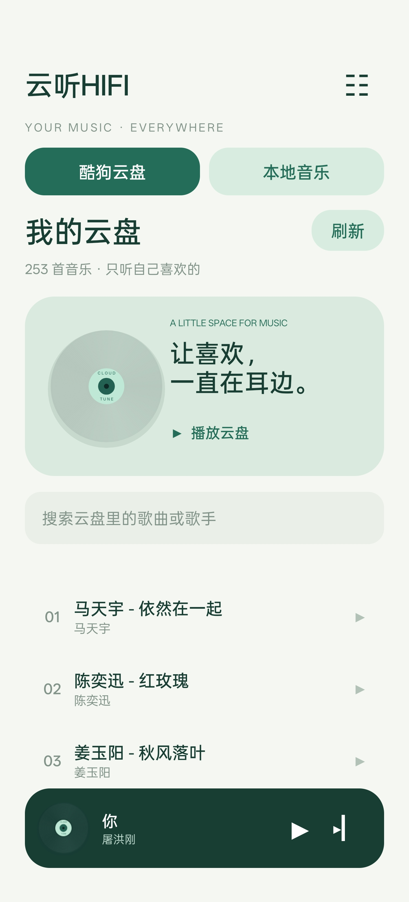
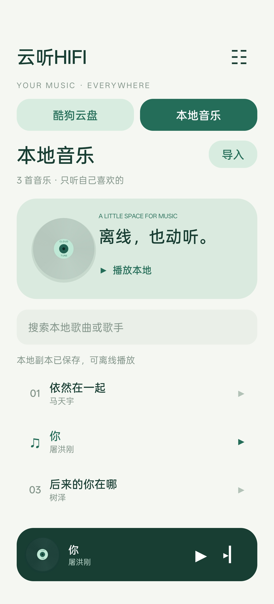
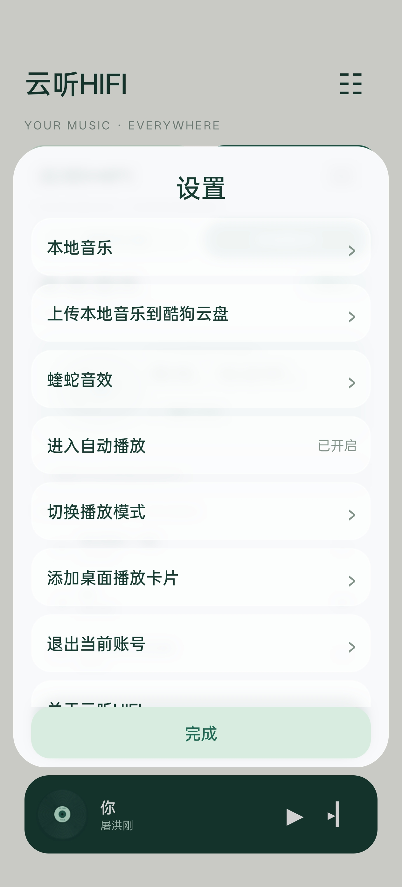
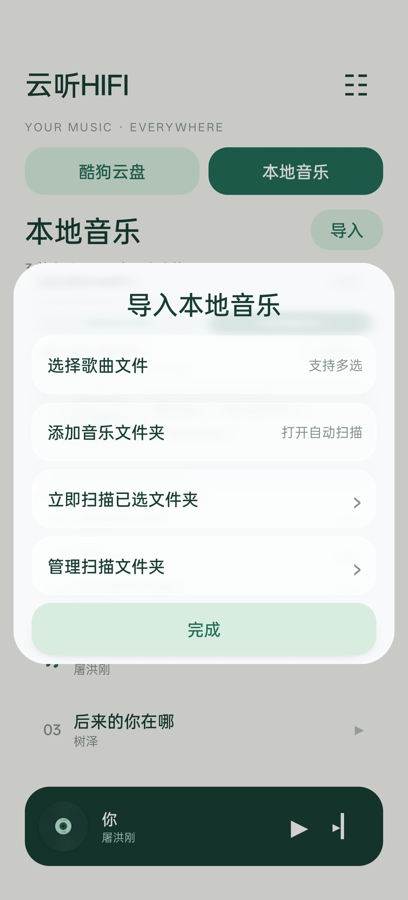
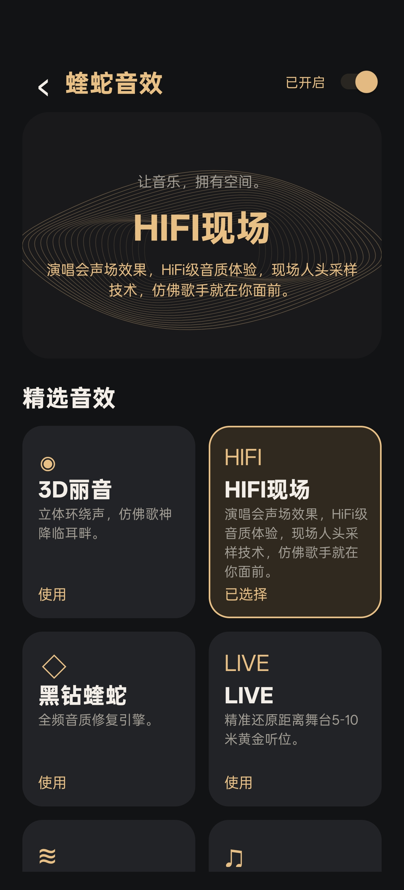

# 云听HIFI 1.0.26

[下载完整 AIDE 源码 ZIP](https://github.com/fuhua301/CloudTune/releases/download/v1.0.26/CloudTune-AIDE-Source-1.0.26-fx.zip)

[下载 1.0.26 APK 安装包](https://github.com/fuhua301/CloudTune/releases/download/v1.0.26/CloudTune-1.0.26.apk)

个人酷狗云盘播放器，基于可播放的 1.0.12 稳定基线，增加内置音效。支持扫码登录、云盘分页、自动播放、歌词、后台播放、贴底控制区和桌面播放卡片。

## 界面预览

<table>
<tr><th>酷狗云盘</th><th>本地音乐</th><th>播放页</th></tr>
<tr>
<td></td>
<td></td>
<td></td>
</tr>
<tr><th>设置</th><th>导入本地音乐</th><th>蝰蛇音效</th></tr>
<tr>
<td></td>
<td></td>
<td></td>
</tr>
<tr><th>扫码登录</th><th></th><th></th></tr>
<tr><td></td><td></td><td></td></tr>
</table>

## 1.0.26 横屏布局

- 横屏首页采用左侧音乐库切换、刷新/导入及播放入口，右侧搜索和歌曲列表；页头、底部迷你播放条收紧。
- 横屏播放页采用左侧写真/歌词与右侧控制栏，控制区在极短窗口下可以滚动。
- 设置及导入菜单根据窗口高度收紧可滚动区域，保留底部完成按钮。
- 旋转后保存当前页面及音乐库选项，旋转恢复不再次触发自动播放。
- 竖屏继续使用原有纵向布局；播放三角形仍按图形中心绘制。
- Android API28/35的800×360及640×280视口验证列表高度、按钮可见性、双栏布局及页面恢复；原生渲染截图已检查，结果见 docs/landscape-test-results.txt。尚未在实体手机实测。

## 响度与菜单

- 首次安装及升级至本版默认开启动态响度增强，之后仍可在音效页手动关闭，并记住选择。
- 导入菜单和扫描文件夹管理菜单与设置共用圆角毛玻璃布局及背景模糊样式。

## 文件夹自动导入

- 播放页顶部返回按钮改为“主页”。
- 本地音乐 → 导入 → 添加音乐文件夹，使用系统选择器授予所选文件夹的持续读取权限。
- 选择后立即扫描；之后每次启动或重新回到应用时自动扫描，包含子文件夹。
- 根据文件大小与修改时间跳过未变更歌曲；新增、修改的文件重新检查内容并去重。来源不提供可靠修改时间时会重新读取检查。
- 导入菜单还提供“立即扫描”和“管理扫描文件夹”。移除扫描关联不会删除已导入的本地副本，外部文件删除也不会移除已有副本。
- 扫描在后台执行，不自动上传到云盘；权限失效时重新添加文件夹即可。
- FolderScanner.java 和 LocalMusic.java 采用基础Java语法与显式资源关闭，单文件Java 6语法检查及全项目Java 8构建通过。
- Android API28/35共8项本地及文件夹逻辑检查通过，见 docs/folder-scan-test-results.txt。尚未在实体手机上验证系统目录选择器和持久授权。

## 本地音乐与云盘上传

- 首页支持“酷狗云盘 / 本地音乐”切换。“本地音乐 → 导入”打开系统文件选择器，支持多选。
- 导入的音乐保存为应用私有副本，不需要广泛存储权限；未登录也能播放。删除外部原文件不影响副本播放。卸载应用会清除这些副本。
- 支持系统能够解码的 MP3、FLAC、M4A、WAV 等音频，读取歌名、歌手及播放时长；同内容去重。
- 设置 → 上传本地音乐到酷狗云盘，登录后选择文件。后台任务先匹配曲库，再取得授权、分片传输、完成传输，最后加密登记到云盘；显示进度并可取消。上传选择也会在本地库保存副本。
- 上传仅连接酷狗 HTTPS 域名，每片最多1 MiB；取消或切换账号时停止后续步骤；最终云盘登记不会自动重试。
- 名称改为“云听HIFI”。首次安装及升级到本版本时默认开启 HIFI现场（预设 ID 9）；之后保留用户调整。
- 设置菜单采用圆角、半透明叠层和在内存中模糊的背景快照，兼容 Android 6.0 及以上。
- 保留写真、两行歌词、完整歌词页、后台播放、锁屏和桌面卡片。
- `docs/local-settings-test-results.txt` 记录 Android API28/35 视图及本地导入逻辑检查；`docs/local-upload-validation.txt` 记录上传状态机与密码协议检查。音频标签在桌面测试中使用模拟数据；真实音频解码及真实酷狗账号上传仍需在手机验证。

## 原有音效功能

- 本版新增 HIFI现场、3D旋转；移除黑钻外放及其独立 IRS 资源。修改为“纯净人声”“黑胶唱片”，LIVE 使用新名称；所有卡片按用户提供文案展示，长说明不截断。
- 删除音效列表中的“原声”卡片。关闭顶部总开关即为原声，重新打开时恢复上次选择。
- 音效页提供 10 种选择，无需导入 APK、库或脉冲文件。
- 原生库放在 `app/src/main/jniLibs/arm64-v8a/`；耳机脉冲和参考预设放在 `app/src/main/assets/soundeffect/`。源码 ZIP 和 APK 均包含运行所需音效文件。
- 设置 → 蝰蛇音效，或播放页底部 → 音效。音效默认开启HIFI现场，点击音效卡片会开启。

| 音效 | 实现与范围 |
| --- | --- |
| 3D丽音 | 用户所供酷狗 APK 的 EFFX 立体环绕核心；并非完整官方 3D丽音预设链 |
| 黑钻蝰蛇 | 原包耳机 IRS，应用自行实现实时分区 FFT 卷积 |
| LIVE | 原版 ViPER 混响，本地调校 |
| 澎湃低音 | 原版 ViPER Bass，本地调校 |
| 纯净人声 | 原版 ViPER Clarity，本地调校 |
| 宽广环绕 | 原版 ColorfulMusic / DiffSurround，本地调校 |
| 电子管 | 原版 Tube 模块 |
| 黑胶唱片 | 原版 AnalogX，本地调校 |
| HIFI现场 | 原包 Virtualizer / HRTF 模块（模式 1） |
| 3D旋转 | 原包 ViPER3DRender，256 帧渲染；本地每 8 秒一圈的声源运动与流式采样率适配 |

卡片说明文案按用户要求展示，不是“5–10米听位”“人头采样”“6N16B 型号”或音质等级的独立验证结论。黑胶唱片延续原 AnalogX 模块，并非新增实测唱片机脉冲。本地调校不等同于酷狗会员的官方预设，也不包含 dts 授权引擎。两个 VPF 文件保留为参考资源，当前未载入完整 VPF 调音链。动态响度增强为可选项，默认关闭。

## 安装与 AIDE Pro

仅支持 **ARM64、Android 6.0 及以上**。同签名可覆盖安装并保留现有登录；自行用 AIDE 打包的版本请继续沿用原签名编译。附带 APK 使用测试签名，签名不同时不能覆盖安装，不要直接卸载已有可用版本。

AIDE 项目使用 Java 8、compileSdk/targetSdk 28、AGP 3.2.1。原生库和自有 JNI 桥接均已附预编译文件，AIDE 无需重新编译 NDK。打开根目录工程构建即可。

电脑独立构建：`python build.py`（Java 17 + Python 3，需要首次下载构建工具）。输出 `dist/CloudTune-1.0.26-fx-test.apk`。该脚本和 Gradle 均自动打包 assets 与 jniLibs。

若修改自有 C 桥接，可安装 `ziglang==0.13.0` 并运行 `python native/build_bridge.py`。原版闭源库没有对应 C/C++ 源码；此 ZIP 是应用完整工程，包含所需预编译二进制，不能称为所有音效算法的开源实现。

## 播放与验证

音频链为 MediaExtractor / MediaCodec → 黑钻卷积（仅黑钻模式）→ 原版 EFFX / ViPER → AudioTrack。单声道转换为立体声。音效关闭后 PCM 链旁路；不支持的解码格式或引擎错误回退原声并显示原因。

3D 环绕和黑钻卷积支持 8–192 kHz；ViPER 本地模式、HIFI现场和3D旋转当前支持 44.1 / 48 kHz。3D旋转核心仅接受 44.1 kHz，48 kHz 使用保持跨块连续性的线性采样率适配器。黑钻分区卷积具有 256 帧固定延迟，并在歌曲结束排出尾音。

- APK 完成 Java 编译、DEX、资源打包、对齐及签名校验；原有 79 项协议/歌曲检查及 3 项旧音效偏好兼容检查通过。
- `docs/convolution-test-results.txt`：分区 FFT 与直接 FIR 对比，包括耳机 IRS、44.1/48 kHz、变长块、双声道、尾音、固定延迟及重采样。
- `docs/viper-mode-test-results.json`：六种原版 ViPER 模块运行后与旁路比较，均有非零音频变化。
- `docs/builtin-bridge-test-results.json`：实际编译的 ARM64 JNI 桥接在十种选择、两种采样率下的处理、切换、旁路和越界拒绝检查。
- `docs/spatial-port-test-results.json`：两个新增模式在 44.1/48 kHz 下处理真实数值信号；3D旋转在不规则音频块下输出与整块完全一致，原版 HRTF 在 90/180/270 度有不同响应。
- **没有真实安卓手机运行与试听结果。** CPU 模拟使用 JNI、动态加载和 libc 替身，不验证安卓链接器、网络解码、蓝牙或扬声器输出。

测试命令：`python tests/OriginalDspEmulation.py`（需 unicorn / pyelftools）；Java 卷积测试入口为 `com.cloudtune.player.ConvolverTests`，传入内置耳机 IRS 路径。`tests/ViperModesEmulation.py` 验证各模块确实不同于旁路。

登录、云盘分页和歌曲地址逻辑保持基线实现，包括后续页 20010 结束翻页并保留已获取歌曲的修复。音效接入不改变账号或云盘请求。

## 组件来源

原版组件来自用户提供的酷狗标准版 20.6.6 APK，文件和哈希见 `docs/bundled-components.json`。这些二进制不是本项目的开源代码，也没有被重新许可。此内置版单独交付，不自动提交到公开仓库。第三方开源依赖见 `THIRD_PARTY.md`。

## 新增原版接口证据

详见 `docs/spatial-port-notes.md`。移植原版 DSP 不意味着已经完整重现官方 EQ、设备适配及会员预设链。原版库和资源仍内置，AIDE 无需导入 APK 或音效。

